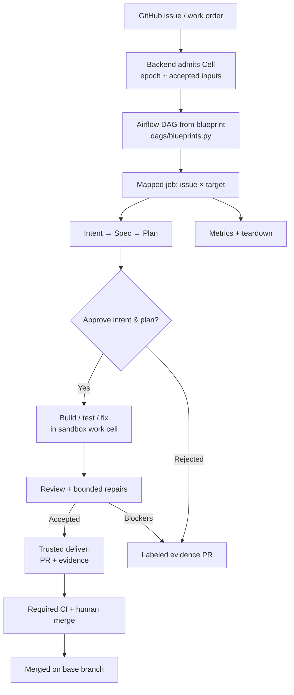
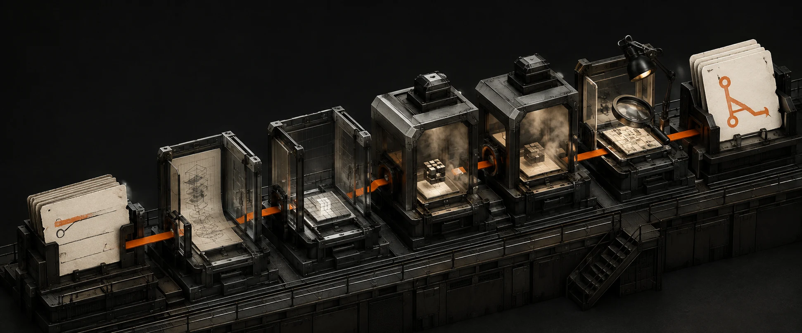

# SWFactory

GitHub issues to reviewed pull requests with coding agents, Airflow, and approval gates. Alpha.

[](https://github.com/zozo123/ariflow-swfactory/actions/workflows/ci.yml)
[](LICENSE)

SWFactory turns an accepted work order into a reviewed change whose evidence and authority survive
the workers that produced it. Apache Airflow (pinned to **3.3.2**) schedules the line; agents run in
bounded work cells; trusted code runs the product tests; the trusted backend owns publication.
On the default line a person approves the intent and the plan, and a person merges the pull request.

Docs site: [https://zozo123.github.io/ariflow-swfactory/](https://zozo123.github.io/ariflow-swfactory/) ·
[Quickstart](#quickstart) · [Operator guide](docs/swf.md) ·
[Walkthrough](https://zozo123.github.io/ariflow-swfactory/#factory-demo)

## From issue to merged PR

One submission creates one Airflow DAG run from an installed blueprint. Each **issue × selected
target** becomes a mapped job. Agents never hold GitHub publishing credentials; the backend does.

1. **Admit** the work order and pin accepted inputs (backend + Factory Cell identity/epoch).
2. **Intent** stage writes `intent.md`; a human gate approves or rejects that digest.
3. **Spec** and **plan** produce requirements and `plan.json` / `plan.md`; a human gate approves the plan.
4. **Build and test** runs bounded agent work, then the product's verification commands from `factory.toml`.
5. Failed builds can **fix** within the blueprint budget, then re-enter build and test.
6. **Review** applies `REVIEW.md` with a bounded repair round.
7. **Deliver** publishes a PR (or a labeled `[REJECTED]` / `[BLOCKED]` evidence PR) with `docs/factory/<issue>/`.
8. **Human merge** (or the experimental docs-only autonomous path) decides whether the change lands.
9. **Metrics and teardown** surround every mapped job; stopping the DAG does not by itself reclaim every sandbox.



Installed blueprints define the DAGs; new issues supply data rather than new Python DAG files. The
[default blueprint](blueprints/default.toml) is the route above. Exhausted build attempts and policy
failures stop progression. Publication alone is not acceptance.

`Plan.work` validates up to 64 issue-specific nodes. `parallel_safe` marks fork candidates; the
default path still uses one governed build/review cell. See [managed lifecycle](docs/lifecycle.md)
and the [system map](docs/system-map.md).

### What arrives with a change

Evidence is committed under `docs/factory/<issue>/`, relative to the product target directory.

| Artifact | Purpose |
| --- | --- |
| `intent.md`, `spec.md` | Original work order, requirements, and open questions |
| `plan.md`, `plan.json` | Planned files, steps, tests, risks, and optional work graph |
| `approvals.json` | Gate decision, actor, time, and approved artifact digest |
| `review.json` | Review verdict, findings, and remaining blockers |
| `metrics.json` | Recorded timing, spend, and delivery signals |
| `agent/` | Agent result envelopes and copied audit records |

Host journals under `.factory/` are control state, kept outside the coding agent's authority.

## Features

| Need | Mechanism |
| --- | --- |
| Repeatable delivery | Versioned TOML blueprints and a product `factory.toml` verification contract |
| Human control | Intent and plan approvals bound to artifact digests |
| Parallel work | Airflow task mapping over issue × target jobs with bounded concurrency |
| Bounded execution | Stage budgets, timeouts, build attempts, and review repair limits |
| Recoverable ownership | Durable Factory Cells, epochs, and operation journals |
| Inspectable delivery | Evidence committed with the change; CLI/TUI inspection |
| Replaceable compute | Local, SRT, Docker, islo, toolset, and boat.dev sandbox adapters |
| Model gateways | Claude through Anthropic or an HTTPS gateway such as Databricks |

An **experimental** autonomous line can approve and merge documentation-only (`docs/**`) changes
under a checked-in policy. It has been tested with hermetic backend and Airflow DAG tests, not as a
live production deployment. Policy and authority changes remain human maintenance.

## Quickstart

Install **Git**, **Python 3.12**, and **[uv](https://docs.astral.sh/uv/getting-started/installation/)**,
then run the bundled replay (verified in this environment):

```sh
git clone https://github.com/zozo123/ariflow-swfactory.git
cd ariflow-swfactory
uv sync --locked
uv run swfactory demo
```

The replay uses authored agent fixtures to change a calculator project, fail a build, repair it,
review the result, and deliver to a local Git remote. Demo approvals are automatic. Dependency
installation needs network access; the replay needs **no model key, GitHub token, Airflow, Docker,
or Rust**. It makes no model calls and opens no GitHub PR.

Verified summary from a local run (`swfactory 2.5.0`):

```text
SCRIPTED REPLAY — agent=scripted, no model calls; fixtures: demo/scripted
setup            ok          …  sandbox=local:work
gate:intent      approve by replay:scripted-replay
gate:plan        approve by replay:scripted-replay
build_and_test   ok          …  iterations=2, tests_count=7
review           ok          …  blockers=0, acceptance_tests=4
deliver          ok          …  commits=3, adherence=1

stages  intent:ok → spec:ok → plan:ok → build_and_test:ok → review:ok → deliver:ok
pr      file://…/.factory/<run_id>/pr.md
```

Inspect the machine-readable report and local PR description:

```sh
uv run swfactory state list
# example: <run_id>  completed  zozo123/ariflow-swfactory #DEMO-1  teardown  $0.0000
```

Artifacts live under `.factory/<run_id>/` (`report.json`, `pr.md`, `work/`, `remote.git`).

Prefer to see the shape first? The [illustrated walkthrough](https://zozo123.github.io/ariflow-swfactory/#factory-demo)
draws the same stages and the two human gates as one diagram.



## Run on boat.dev

<a href="https://boat.dev"></a>

**Cloud work cells on [boat.dev](https://boat.dev), governed by SWFactory.** The existing adapter
creates a credential-free VM, clones the target, runs the stages, retains delivery evidence, and
stops the VM. Airflow remains the lifecycle scheduler.

```sh
# Export BOAT_API_KEY from your secret manager; never commit it.
uv run swfactory demo --sandbox boat
```

This exercises a real hosted VM with scripted agent fixtures and local Git delivery. Direct Claude
execution on boat is currently refused because the adapter does not yet provide a scoped model
credential path. For real Claude calls through Databricks, use the
[Docker gateway rehearsal](docs/model-gateways.md). Inspect the report and review verdict: a
completed run can correctly publish blocked evidence when acceptance tests are missing.

| End-to-end check | What it exercises |
| --- | --- |
| `scripts/swf_e2e.sh` | Live Airflow, backend admission, human gates, independently verified deliveries |
| `uv run swfactory demo --sandbox boat` | Hosted boat VM, stage execution, review, local publication, teardown |
| [Databricks rehearsal](docs/model-gateways.md) | Real model calls, bounded build and review, credential-free tests |

## Choose a run

| Path | Approvals and delivery | Start here |
| --- | --- | --- |
| Local replay | Fixture approvals, no model calls, local Git delivery | The quickstart above |
| Human-approved work | An operator answers artifact gates and merges the resulting PR | [Operator guide](docs/swf.md) |
| Autonomous documentation work (experimental) | Repo policy approves gates; the backend verifies checks and merges | [Autonomous operating guide](docs/autonomous.md) |

Autonomy requires a deployed backend, Airflow, and configured model/sandbox access. Inspect
policy refusals with `uv run swfactory state autonomy --json`; set `SWF_BACKEND_URL` and
`SWF_BACKEND_TOKEN` to read the deployed backend, or use `--root` with its local state directory.

## Run a real issue

Start with a repository you can use for evaluation. The project is **alpha**. A real run requires
configured GitHub access, a supported agent environment, and model/provider credentials; it can
incur costs and publish a PR.

### 1. Define how the product is verified

Add `factory.toml` at the product target's root. For a Python project with pytest in its `dev` group:

```toml
[commands]
test = "uv run --group dev pytest --junitxml=.factory/junit.xml"
lint = "uv run --group dev python -m compileall -q src"

[paths]
source = "src"
tests = "tests"
junit = ".factory/junit.xml"
protected = ["factory.toml", ".github/"]
```

Adapt the commands and paths to the product. Tests must run non-interactively, return a nonzero
exit code on failure, and produce fresh JUnit XML. The factory refuses a target without this
contract. See the [bundled example](demo/target/factory.toml).

### 2. Configure the factory line

Copy [blueprints/default.toml](blueprints/default.toml) to `blueprints/your-product.toml`. Set
`[blueprint].name = "your-product"`, choose the target `repo` and `base_branch`, and use `dir = ""`
for a repository-root target. The supplied line targets this repository's calculator demo.

The defaults are two approval gates with 24-hour timeouts, three build attempts, one review repair
round, a $2 model budget per stage and $8 per job, a three-hour stage timeout, and four concurrent
mapped jobs. These are configured limits, not cost or latency measurements. Operational `SWF_*`
settings can override line defaults. Submitted targets can only narrow the installed line's scope.

### 3. Deploy, connect, and submit

Follow [real-repository setup](OPERATIONS.md#run-it-on-a-real-github-repository), then the
[Docker rehearsal](docs/docker.md) or [hosted islo deployment](docs/islo.md). Configure the
[factory backend](docs/factory-backend.md) with installed blueprints, Airflow access, and service
credentials. Its default address is loopback port `8082`.

[Install the Rust console](docs/swf.md#install) and set `SWF_BACKEND_TOKEN` on the operator machine
to the same secret configured on the backend. With the services running:

```sh
swf context add local --backend-url http://localhost:8082 \
  --airflow-url http://localhost:8080 --repo your-org/your-product --use
swf doctor
swf submit --blueprint your-product --issue 42
swf attention
swf gates list
swf tui
```

Use a real issue number from the configured product repository. Review individual gates with
`swf gates review '<gate-id>'`, then answer with `swf gates approve '<gate-id>'` using the exact
ID returned by `swf gates list`. Gate writes recheck readiness and the TUI binds the decision to
the evidence revision under review. Inspect published results with `swf deliveries list`.

<details>
<summary>Direct CLI rehearsal without an Airflow service</summary>

After configuring the line and the islo/Claude/GitHub environment described above:

```sh
uv run swfactory doctor \
  --blueprint your-product --agent claude --sandbox islo --scm github
uv run swfactory run \
  --blueprint your-product --issue 42 \
  --agent claude --sandbox islo --scm github --approve prompt
```

This invokes the shared Python stages directly with terminal approvals. It can publish a real PR.
The remote cell is removed when the run ends, as the DAG's teardown does; pass `--keep-sandbox` to
leave it up for inspection or a rerun with the same `--run-id`. It does not provide a backend-managed Airflow lifecycle or establish managed Cell authority merely
by sharing stage code. Use the deployed path for managed concurrency, durable approval waits, and
centralized publication.

</details>

## Configuration and secrets

List secret **names** only. Put values in a secret manager or an unlogged shell; never commit them,
never place them in blueprints, issues, XCom, or coding sandboxes.

| Name | Where it is needed | Purpose |
| --- | --- | --- |
| `SWF_BACKEND_TOKEN` | Backend process, Airflow workers, operator machine | Bearer authority for the factory API (32+ non-whitespace characters) |
| `SWF_BACKEND_URL` | Airflow workers, optional operator override | Backend base URL for managed cells |
| `GH_TOKEN` or `GITHUB_TOKEN` | Trusted backend / orchestrator only | GitHub read and publication |
| `ANTHROPIC_API_KEY` | Model worker / sandbox gateway for Claude | Direct Anthropic model calls |
| `ANTHROPIC_AUTH_TOKEN` | Model worker with HTTPS `ANTHROPIC_BASE_URL` | Bearer gateway (for example Databricks) |
| `ANTHROPIC_BASE_URL` / `ANTHROPIC_MODEL` | Same worker as the auth token | Gateway URL (port 443) and model id |
| `BOAT_API_KEY` | Process that creates boat work cells | boat.dev hosted VMs |
| `ISLO_API_KEY` | Orchestrator that spawns islo MicroVMs | Hosted islo control plane |
| `GITHUB_WEBHOOK_SECRET` | Webhook receiver | HMAC verification of GitHub delivery |
| `AIRFLOW_PASSWORD` or `AIRFLOW_TOKEN` | Operator / backend Airflow client | Airflow API authentication |
| `OPENAI_API_KEY` / `PRIME_API_KEY` | Only if an external-agent profile declares them | Provider keys named by that profile |

Operational knobs use the `SWF_*` prefix (or matching CLI flags). Context files store credential
**environment-variable names**, not values. For Claude through Databricks or another HTTPS gateway,
see [model gateway setup](docs/model-gateways.md). The factory never forwards `DATABRICKS_TOKEN`,
`ISLO_API_KEY`, `GH_TOKEN`, or `SWF_BACKEND_TOKEN` into the model process.

## How it works

| Component | Owns | Entry point |
| --- | --- | --- |
| Apache Airflow 3.3.2 | Managed lifecycle scheduling, mapped jobs, retries, and human approval waits | [Blueprint DAGs](dags/blueprints.py) |
| Factory Cell control plane | Durable issue × target identity, epoch, and managed mutation records | [Cells](src/swfactory/cells.py), [backend](src/swfactory/backend/) |
| Python `swfactory` | Stage execution, verification, trusted publication, local replay, and backend service | [Runtime](src/swfactory/runtime.py), [stages](src/swfactory/stages.py) |
| Rust `swf` | Operator CLI/TUI for submission, gates, inspection, and delivery verification | [Operator reference](docs/swf.md) |
| Agent and sandbox adapters | Stage-scoped work in replaceable compute | [Execution design](docs/design.md) |

### Repo layout

```text
blueprints/        production routes and their limits (one TOML → one Airflow DAG)
dags/              Airflow DAG builders, approvals, and maintenance
src/swfactory/     runtime, stages, adapters, state, policy, backend, CLI
rust/              swf operator binary: domain, adapters, operations, TUI, CLI
demo/              scripted calculator target, fixtures, and issue used by `swfactory demo`
deploy/docker/     local Airflow + Docker work-cell stack
deploy/islo/       hosted control plane and MicroVM work cells
config/            capability inventory and autonomous policy
skills/            installable agent skills (airflow-software-factory, swfactory)
docs/              design, deployment, evaluation, and operations guides
site/              GitHub Pages guide
scripts/           e2e, stress, and release helpers
tests/             hermetic and integration checks
factory.toml       this repository's own product verification contract
```

### Execution and trust boundaries

Connect an independently installed stage harness through the [external agent contract](docs/external-agents.md).

Coding agents receive stage-specific tools and protected-path rules. Trusted Python code runs the
product's verification commands, validates patches, scans for secrets, and publishes. Coding
sandboxes receive no GitHub publishing credential. In backend-managed runs, GitHub publication
credentials remain on the backend and workers use its SCM proxy.

Every profile below carries its [capability claim](config/capability-inventory.json) and that
claim's support level; a profile without a claim is an integration seam, not an available sandbox.

<!-- capability-surface:sandboxes -->
| Sandbox | Capability claim | Support | Use and boundary |
| --- | --- | --- | --- |
| `local` | [`sandbox.local-scripted`](config/capability-inventory.json) | test only | Scripted replay and development; no isolation boundary |
| `srt` | [`sandbox.srt`](config/capability-inventory.json) | experimental | Anthropic Sandbox Runtime filesystem and network restrictions on the local machine |
| `docker` | [`sandbox.docker`](config/capability-inventory.json) | experimental | Container execution for development and rehearsal; shares the host kernel |
| `islo` | [`sandbox.islo`](config/capability-inventory.json) | experimental | Remote MicroVM execution with configured gateway and environment |
| `toolset` | none | adapter | Airflow common.ai sandbox adapter; capabilities depend on its configured backend |
| `boat` | none | adapter | boat.dev hosted VM work cells for the WorldGen pilot line; `BOAT_API_KEY` in the environment; no swfactory-enforced egress allowlist; no model credential path yet |

An experimental [SmolVM backend](docs/smolvm.md) is available through `toolset` with
`SWF_TOOLSET_BACKEND=smolvm`. It uses a host-owned Unix socket and durable attempt records;
native TTL and provider-fork execution are not enabled by this integration. `swfactory doctor`
checks daemon health and readiness without provisioning a VM.

Provider capabilities differ. A warm-start snapshot does not establish live-fork support. The
Docker rehearsal mounts the host Docker socket and belongs on a host you control. Model credentials
are supplied only through the selected agent/provider configuration; backend and publishing secrets
stay outside coding sandboxes.

The backend token grants operator authority within a trusted deployment. Stopping an Airflow run
does not itself kill every process or reclaim its sandbox. Follow the
[recovery guide](docs/run-recovery.md) for inspection and cleanup, and
[SECURITY.md](SECURITY.md) for security reporting.

## Development and testing

Verified on Python 3.12 with the locked environment:

```sh
uv sync --locked
uv run ruff check .
uv run ruff format --check .
uv run pytest
uv run swfactory demo
```

For scheduler work, install the pinned Airflow group (Apache Airflow **3.3.2**) and run the DAG
checks (68 passed in this environment for parity + smoke):

```sh
uv sync --locked --group airflow
uv run --group airflow ruff check .
uv run --group airflow ruff format --check .
uv run --group airflow pytest
uv run --group airflow swfactory demo
uv run --group airflow pytest tests/test_dag_parity.py tests/test_dag_smoke.py
uv run --group airflow python -m swfactory.liquid_spec
uv run --group airflow python -m swfactory.evals
```

Rust contributors also run the workspace's formatting, clippy, test, and release-build checks;
see [CONTRIBUTING.md](CONTRIBUTING.md) and the [Rust workspace](rust/README.md).

For complementary partial repairs, the experimental
[candidate fusion workflow](docs/campaign-fusion.md) runs bounded repair and diagnostic
experiments, composes or synthesizes their contributions, checks the resulting program,
and retains a passing fallback. Run `uv run swfactory demo --fusion` for the keyless
end-to-end replay; trusted blueprints opt into the managed runtime with `[fusion]`.

## Agent skills

Two repository skills cover adoption and operation. Installing a skill gives an assistant
instructions; it does not deploy Airflow or provision a backend.

| Skill | Use it for |
| --- | --- |
| [`airflow-software-factory`](skills/airflow-software-factory/SKILL.md) | Adopt, configure, deploy, and operate the factory |
| [`swfactory`](skills/swfactory/SKILL.md) | Drive an existing factory as an outer coding harness with stable session identity |

```sh
npx skills add zozo123/ariflow-swfactory --skill airflow-software-factory --skill swfactory
```

[Browse the catalog](https://skills.sh/zozo123/ariflow-swfactory) · [Installation details](skills/README.md)

For a configured harness, keep `(harness, factory_id)` stable throughout one session:

```sh
swf submit --harness codex --factory-id codex-session-17 --blueprint your-product --issue 42
```

Airflow continues to own lifecycle scheduling. See the
[`swfactory` skill](skills/swfactory/SKILL.md) and
[concurrent harness methodology](docs/harness-concurrency-methodology.md).

## Status and verification

For Claude through Databricks or another HTTPS model gateway, see [model gateway setup](docs/model-gateways.md).

This is an alpha implementation with executable delivery paths and a broader set of architectural
contracts. Read capability claims at their demonstrated level:

| Evidence | What it establishes |
| --- | --- |
| Local replay and scripted evals | Pipeline behavior, repair paths, policy outcomes, and retained artifacts |
| Cell, journal, and backend tests | The specific identity, mutation, and recovery behaviors exercised |
| Liquid spec manifest | Declared coverage of 90 domains × 10 concerns = 900 slices; not 900 independently proven features |
| Provider and live scheduler checks | Behavior of the tested environment and scenario; inspect each check's result |
| Native workgraph forks and recursive factories | Contracts and bounded primitives exist; these are not default end-to-end production guarantees |

### Capability claims

[`config/capability-inventory.json`](config/capability-inventory.json) is the single public truth for
every claimed feature. The table below is generated from it, each `Verified by` reference resolves to
a file or a CI job that exists, and a test refuses any sentence in this README or on the site that
describes a capability more strongly than its claim.

The experimental work executor observes cancellation before and between merge callbacks.
A merge callback already in flight is not interrupted or rolled back.

<!-- capability-inventory:start -->
<!-- Generated from config/capability-inventory.json; run `uv run python -m swfactory.capability_inventory --write`. -->

| Claim | Support | Runtime entry | Verified by |
| --- | --- | --- | --- |
| `airflow.lifecycle` | `supported` | `swfactory.backend.service.Factory.submit -> Airflow DAG run` | ci:airflow-parity required check plus scripts/stress_airflow.sh |
| `mutation.github` | `supported` | `swfactory.core_capabilities.CoreCapabilityRuntime.execute_external via ControlKernel` | tests/test_core_capabilities.py (fenced, replayed and evidenced execute_external) |
| `recovery.external-effects` | `supported` | `swfactory.idempotency.OperationJournal and swfactory.operation_recovery` | tests/test_recovery_acceptance.py |
| `workgraph.serial` | `supported` | `swfactory.work_stage.build_and_test (the Airflow build task dags/blueprints.py selects) -> bounded Plan.work execution` | tests/test_workgraph_stage_execution.py |
| `workgraph.provider-fork` | `experimental` | `swfactory.work_stage.build_and_test -> swfactory.fork_wave.run_wave (WorkExecutor fan-out/fan-in over swfactory.boat.BoatSandbox forks; opt-in limits.max_parallel_forks)` | tests/test_fork_wave_e2e.py (fork wave end to end over the measured boat lifecycle: fan-out, node-id-ordered fan-in, halt on failure, scope conflict, stale snapshot, crash recovery; opt-in live boat.dev run) plus tests/test_work_executor.py |
| `sandbox.local-scripted` | `test_only` | `swfactory demo` | ci:test-core mandatory leg (its e2e demo step) plus tests/test_stages_scripted.py |
| `sandbox.srt` | `experimental` | `swfactory.sandbox.SrtSandbox` | ci:srt-smoke plus the SrtSandbox argv contracts in tests/test_sandbox_argv.py |
| `sandbox.docker` | `experimental` | `swfactory.sandbox Docker path` | ci:docker-smoke |
| `factory.generations` | `experimental` | `generation manifests and parent-owned promotion path` | tests/test_generation_contract.py |
| `sandbox.islo` | `experimental` | `swfactory.sandbox.IsloSandbox (islo use / cp / rm control plane)` | ci:evals-islo in .github/workflows/evals.yml (a real claude run inside a MicroVM) plus the hermetic argv contracts in tests/test_sandbox_argv.py |
| `selfhost.factory` | `experimental` | `swfactory run --blueprint selfhost (target dir is the repo root), executing swfactory.stages against the factory's own tree` | tests/test_selfhost.py (contract parses, every protected entry survives literal-prefix reduction, confinement modules are refused for build and fix, both gates are non-auto, one line serves both backends) |
| `sandbox.smolvm` | `experimental` | `swfactory.smolvm_backend.SmolvmSandboxBackend via ToolsetSandbox` | tests/test_smolvm_backend.py (HTTP contract) and opt-in tests/test_smolvm_live.py |
| `factory.phase-control` | `experimental` | `swfactory.phase_control and swf_domain::phase_control; swfactory phase-assess and swf phase are read-only` | tests/test_phase_control.py plus rust/crates/swf-domain/tests/phase_control_contract.rs using tests/fixtures/contract/phase_control.json |
| `factory.recursive-search` | `experimental` | `swfactory.recursive_search; swfactory research-adapt` | tests/test_recursive_search.py |
| `factory.swarm-dynamics` | `experimental` | `swfactory.swarm_dynamics via swfactory.recursive_search.plan_adaptive_round; managed provider execution from factory.population-execution` | tests/test_swarm_dynamics.py |
| `factory.population-manifest` | `experimental` | `swfactory.population_manifest via swfactory.recursive_search.plan_adaptive_round; swfactory population-summarize` | tests/test_population_manifest.py |
| `factory.provider-binding` | `experimental` | `swfactory.provider_binding; swfactory population-bind` | tests/test_provider_binding.py |
| `factory.population-execution` | `experimental` | `swfactory.execution_binding.execute_managed_population -> swfactory.backend_population.BackendPopulationRunner -> /v1/population/execute -> swfactory.backend.population_service` | tests/test_population_execution.py; tests/test_backend_population.py; tests/test_managed_population_e2e.py |
| `factory.population-provider-adapter` | `experimental` | `swfactory.population_adapter.HttpPopulationAdapter via swfactory.backend.population_service` | tests/test_population_adapter.py; tests/test_backend_population.py; tests/test_managed_population_e2e.py |
| `factory.adaptive-information-budget` | `experimental` | `swfactory.adaptive_information; swfactory population-budget; swfactory.recursive_search.plan_adaptive_round; managed population stage retention` | tests/test_adaptive_information.py and tests/test_recursive_search.py |
| `factory.formal-claims` | `experimental` | `formal/authority/AuthorityKernel.tla` | formal/authority/AuthorityKernel.tla (TLC model; not run in CI) |
| `autonomous.issue-to-merge` | `experimental` | `swfactory.backend.autonomous_service -> Airflow autonomous DAG` | tests/test_autonomy.py and tests/test_dag_parity.py |
| `factory.replica-fusion` | `experimental` | `swfactory.work_stage.build_and_test -> swfactory.replica_fusion.execute_fusion_stage` | tests/test_replica_fusion.py and tests/test_campaign_fusion.py; ci:test-core fusion demo step |
| `factory.adherence-audit` | `experimental` | `swfactory.stages.deliver -> swfactory.adherence.audit` | tests/test_adherence.py (adherent scripted run, deviant role, tool, budget and gate cases, unverifiable missing evidence, read-only worktree hold) plus tests/test_agent.py |

<!-- capability-inventory:end -->

Provider-fork execution remains experimental and requires every work node to set
`parallel_safe=True`; a mixed or default plan uses serial execution.

[CI](.github/workflows/ci.yml) gives internal fan-out PRs the fast Python gate and main-targeted
PRs the integration matrix. The pinned live-gate, SRT, Docker, and upstream sandbox-toolset jobs
currently use `continue-on-error`; the separate [eval workflow](.github/workflows/evals.yml) is
path-filtered, scheduled, or manually triggered, and real-agent jobs need configured secrets.
**A green badge does not mean every live path passed.** The
[methodology's promotion rules](docs/liquid-methodology.md#ci-and-promotion) define the stronger
acceptance standard and explain the remaining enforcement work.

## Method

> **Create entropy where exploration benefits from it; destroy entropy before promotion.**

The factory runs product work and its own development the same way: explore through independent
lanes, compare them against shared contracts and evidence, then converge on one maintained
implementation and one exact candidate. **Parallelism is cheap. Authority is singular.**

| Motion: may change or disappear | Matter: must remain durable and authoritative |
| --- | --- |
| Workers, agent sessions, sandboxes, VMs, containers | Factory Cell identity, current epoch, work order, and lifecycle binding |
| Speculative branches, experiments, temporary adapters | Approved contracts, mutation history, evidence, and publication state |
| Intermediate implementations, work graphs, and caches | The accepted plan revision and the final repository state |

A worker may spend compute; it cannot mint authority. A cache hit can save time; it cannot approve
a gate, reconcile an ambiguous mutation, publish a PR, or promote a candidate.

| Read next | For |
| --- | --- |
| [Liquid methodology](docs/liquid-methodology.md) | Ownership roles, concerns, recovery cases, evidence requirements, and promotion rules |
| [Phase control](docs/phase-control.md) | The search-only gas/liquid/critical/crystal/glass/jammed vocabulary shared by Python and Rust |
| [Future factory](docs/future-factory.md) | The north-star end state, its laws, and what to build next |
| [Polyglot task graph](docs/polyglot-task-graph.md) | Turbo as an accelerator inside verification, not a second scheduler |

## Troubleshooting and FAQ

**`uv sync` fails.** You need network access to download locked wheels. Confirm Python 3.12 and a
working [uv](https://docs.astral.sh/uv/) install, then retry from the repository root.

**`swfactory demo` refuses the target.** The demo target ships its own `factory.toml`. A custom
target without `[commands].test`, JUnit output, or protected paths is refused; copy
[demo/target/factory.toml](demo/target/factory.toml) as a starting point.

**Where did my local PR go?** Scripted delivery writes `.factory/<run_id>/pr.md` and a local bare
remote under `.factory/<run_id>/remote.git`. Use `uv run swfactory state list` to find the run id.

**`swfactory doctor` is red.** Read each check's fix line. Common causes: missing `SWF_BACKEND_TOKEN`
(32+ characters), unset model credential (`ANTHROPIC_API_KEY` or `ANTHROPIC_AUTH_TOKEN` with
`ANTHROPIC_BASE_URL`), missing `BOAT_API_KEY` for `--sandbox boat`, or `gh` / `GH_TOKEN` unable to
read the blueprint repo.

**Claude on boat is refused.** Expected today: the boat adapter has no scoped model credential path
yet. Use scripted fixtures on boat, or real Claude through the
[Databricks / HTTPS gateway rehearsal](docs/model-gateways.md) on Docker/`srt`/`toolset`.

**A published PR still shows `[BLOCKED]`.** Delivery can publish evidence while review blockers
remain. Treat publication, required CI, and merge as separate results; see the
[delivery verifier](docs/swf.md).

**Airflow finished but a sandbox is still up.** Teardown can leave recovery debt. Follow
[run recovery](docs/run-recovery.md); do not assume cancelling a DAG run reclaims every VM.

**Does a green CI badge mean every sandbox works?** No. Some live jobs use `continue-on-error`, and
eval workflows need configured secrets. Trust [capability claims](#capability-claims) and the exact
check results for the head you care about.

**Can agents merge their own PRs?** Not on the default line. Merge stays with a human (or the
experimental docs-only autonomous policy). Agents never receive GitHub publishing credentials in
coding sandboxes.

## Documentation and contribution

| Goal | Start here |
| --- | --- |
| Understand the flow, concepts, current ownership, and finish line | [System map](docs/system-map.md), [design rationale](docs/software-atelier.md) |
| Understand and apply Liquid development | [Methodology](docs/liquid-methodology.md) |
| Deploy or run against GitHub | [Operations](OPERATIONS.md), [Docker](docs/docker.md), [islo](docs/islo.md) |
| Run the factory against itself | [Self-hosting](docs/selfhost.md) |
| Operate Cells, jobs, approvals, and deliveries | [CLI/TUI](docs/swf.md), [backend API](docs/factory-backend.md) |
| Design lifecycle and parallel work | [Lifecycle](docs/lifecycle.md), [architecture](docs/design.md), [harness efficiency](docs/harness-efficiency.md) |
| Receive work and recover interruptions | [Webhooks](docs/webhooks.md), [Linear intake](docs/native-linear-intake.md), [run recovery](docs/run-recovery.md) |
| Evaluate behavior and control proposals | [Phase control](docs/phase-control.md), [formal correctness](docs/formal-correctness.md), [Evals](docs/evals.md) |
| Extend or review the factory | [Contributing](CONTRIBUTING.md), [review policy](REVIEW.md), [changelog](CHANGELOG.md) |

Contribute a coherent change with an explicit invariant, failure behavior, evidence, and a plan to
remove superseded paths. Use the [current execution plan](docs/system-map.md#a-finish-line-that-can-be-demonstrated)
and [open issues](https://github.com/zozo123/ariflow-swfactory/issues?q=is%3Aissue%20is%3Aopen) to choose work.
The earlier [execution plan #2040](https://github.com/zozo123/ariflow-swfactory/issues/2040) and
[convergence roadmap #2022](https://github.com/zozo123/ariflow-swfactory/issues/2022) are retained as
historical context.

For bounded unattended issue-to-merge operation, see [autonomous runs](docs/autonomous.md).

## License

Licensed under the [Apache License 2.0](LICENSE).
